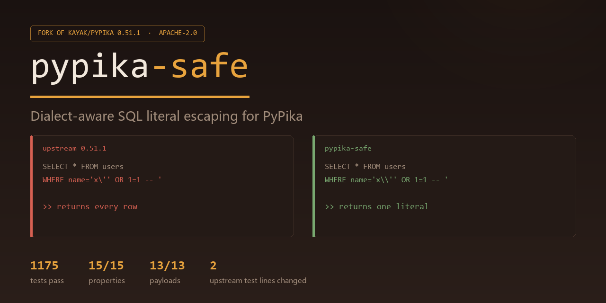

# pypika-safe



**A drop-in replacement for [PyPika](https://github.com/kayak/pypika) that fixes its dialect-blind literal escaping and NULL semantics.**

PyPika is a well-designed SQL query builder, but it renders string literals the same way for every database: it doubles the quote character and nothing else. That is correct for PostgreSQL and SQLite, and **wrong for MySQL and ClickHouse**, where a backslash also escapes the next character. The result is a real SQL injection path in any MySQL application that passes user input through `Query.where(field == value)`.

`pypika-safe` is a fork of PyPika 0.51.1 (Apache-2.0) that keeps the entire public API and fixes the value-emission layer.

```python
# pip install pypika-safe   (or: pip install -e .)
from pypika import MySQLQuery, Table

users = Table("users")
payload = "x\\' OR 1=1 -- "

# upstream 0.51.1
#   SELECT * FROM `users` WHERE `name`='x\'' OR 1=1 -- '
#   -> the literal closes early; every row is returned
#
# pypika-safe
#   SELECT * FROM `users` WHERE `name`='x\\'' OR 1=1 -- '
#   -> one literal, one row, or none
MySQLQuery.from_(users).select(users.star).where(users.name == payload).get_sql()
```

---

## Table of contents

- [What was actually broken](#what-was-actually-broken)
- [What this fork changes](#what-this-fork-changes)
- [Install](#install)
- [Usage](#usage)
- [Verification](#verification)
- [Compatibility and migration](#compatibility-and-migration)
- [What this fork does *not* do](#what-this-fork-does-not-do)
- [Project layout](#project-layout)
- [License and attribution](#license-and-attribution)

---

## What was actually broken

Everything below was reproduced against `kayak/pypika` at `master` (0.51.1) before any code was changed. The reproduction scripts live in [`tools/`](tools) and run against either checkout.

### 1. Backslash escaping is dialect-blind (SQL injection on MySQL / ClickHouse)

`ValueWrapper.get_formatted_value` called `format_quotes(value, quote_char)`, which only doubles the quote:

```python
def format_quotes(value, quote_char):
    if quote_char:
        value = str(value).replace(quote_char, quote_char * 2)
    return f"{quote_char}{value}{quote_char}"
```

On MySQL a backslash escapes the character after it, so a value ending in `\` swallows the closing quote, and `\'` escapes the quote that the doubling just produced:

| Python value | upstream SQL (MySQL) | what MySQL sees |
|---|---|---|
| `a\` | `` 'a\' `` | unterminated literal |
| `x\' OR 1=1 -- ` | `` 'x\'' OR 1=1 -- ' `` | `name = 'x'` **OR 1=1** |
| `back\\slash` | `` 'back\\slash' `` | `back\slash` (one backslash lost) |

This is upstream issue [#844](https://github.com/kayak/pypika/issues/844) (open since 2025-07) and the older [#238](https://github.com/kayak/pypika/issues/238) (open since 2019). The README advertises parameterisation as the way to "avoid SQL-injection related risks", but the default literal path is the one most callers use.

### 2. `field == None` renders `= null` and silently matches nothing

`Field.__eq__` wraps `None` into `NullValue`, which renders the keyword `null`, producing `WHERE "deleted_at"=null`. That is syntactically valid and always `UNKNOWN`. Measured on SQLite, DuckDB and PostgreSQL semantics: **zero rows**, where the caller meant `IS NULL`.

### 3. `IN` / `NOT IN` mishandle `None` and empty lists

- `isin([1, None])` → `IN (1,null)` — never matches anything, because `x IN (1, NULL)` is `UNKNOWN` for every `x`.
- `notin([1, None])` → `NOT IN (1,null)` — never matches anything either, for the same reason.
- `isin([])` → `IN ()` — a **syntax error** on PostgreSQL, Oracle, MSSQL and DuckDB (SQLite happens to accept it as an extension).

### 4. Bound parameters carry SQL fragments instead of values

`ValueWrapper.get_sql(parameter=...)` stored `self.get_value_sql(...)` — the already-quoted SQL text — as the parameter value:

```python
sql, params = q.get_sql(parameter=QmarkParameter()), p.get_parameters()
# 'SELECT ... WHERE "name"=?', ["'foobar'"]      <- the driver receives the quotes
```

and every non-`int`/`float` type was stringified, so `datetime.date` arrived at the driver as `'2024-02-22'`, `Decimal` as `'3.14'`, `bytes` as the repr `"b'abc'"`.

### 5. `bytes` leak `repr()` into the SQL text

`b"abc"` was rendered as the literal `b'abc'` — a four-character string with a stray `b`, not binary data.

### 6. LIKE patterns from user input are treated as wildcards

`Field.like("100%_off")` emits `LIKE '100%_off'`, where `%` and `_` are wildcards. There was no helper to escape them, so a "search by name" box built this way matches far more than the user typed.

---

## What this fork changes

One theme only: **the value-emission layer**. No new query features, no parser, no ORM.

### `pypika/safety.py` (new)

| Function | Purpose |
|---|---|
| `escape_string_literal(value, quote_char="'", dialect=None, backslash_escapes=None)` | Render a `str` as a dialect-correct SQL literal. |
| `escape_like_pattern(value, escape_char="\\")` | Escape `%`, `_` and the escape character in a LIKE pattern. |
| `like_escape_clause(escape_char="\\", dialect=None)` | The matching `ESCAPE '<char>'` fragment. |
| `assert_safe_identifiers(query, quote_char='"')` | Audit a built query for identifiers that would leak when emitted unquoted. |
| `is_plain_identifier(name)` | `True` for `[A-Za-z_][A-Za-z0-9_$]*`. |

Exceptions: `UnsafeLiteralError`, `UnsafeIdentifierError`, `AmbiguousNullCriterionError`.

The escaping rules:

| Dialect family | Backslash | Quote | Control characters | NUL |
|---|---|---|---|---|
| PostgreSQL, SQLite, Oracle, MSSQL, Snowflake, Vertica, Redshift | literal | doubled | raw | **rejected** (PostgreSQL cannot store it) |
| MySQL, ClickHouse | doubled (`\\`) | doubled | named (`\n`, `\r`, `\t`, `\b`, `\Z`, `\0`) | named (`\0`) |

The quote is always *doubled*, never backslash-escaped, so the output stays parseable even when a MySQL session runs with `NO_BACKSLASH_ESCAPES`. That mode is exposed as a knob:

```python
MySQLQuery.from_(users).select("*").where(users.name == "a\\").get_sql(backslash_escapes=False)
# SELECT * FROM `users` WHERE `name`='a\'      <- correct for NO_BACKSLASH_ESCAPES
```

### `pypika/terms.py` (modified)

- `ValueWrapper.get_formatted_value` delegates string rendering to `escape_string_literal`, and rejects `bytes`.
- `ValueWrapper.get_sql(parameter=...)` passes `get_parameter_value()` — the raw Python value — to the driver. `Enum` is unwrapped; everything else keeps its type.
- `BasicCriterion.get_sql` emits `IS NULL` / `IS NOT NULL` when the right-hand side is a null literal. Applies to `where()`, `on()`, and nested boolean expressions.
- `ContainsCriterion.get_sql` raises `AmbiguousNullCriterionError` for `IN`/`NOT IN` with a `None` member, and renders `1=0` / `1=1` for an empty list.
- New `LikeCriterion` plus `Field.like_literal()` / `Field.not_like_literal()`, which escape the pattern and emit the `ESCAPE` clause together.
- `JSON` literals use the same escaper.

### `pypika/queries.py` (modified)

`QueryBuilder.BACKSLASH_ESCAPES = None` (infer from dialect) is propagated through `_set_kwargs_defaults`, so it can be set per builder or per `get_sql()` call.

---

## Install

```bash
pip install -e .
```

Requires Python 3.9+. The only runtime dependency is `typing_extensions` on Python < 3.11, same as upstream. Nothing else was added.

Verification tools need extras:

```bash
pip install -r requirements-dev.txt    # pytest, parameterized
pip install -r requirements-verify.txt  # sqlglot, duckdb (only for tools/)
```

## Usage

### Escaping is automatic

```python
from pypika import ClickHouseQuery, MySQLQuery, PostgreSQLQuery, Table

t = Table("users")

MySQLQuery.from_(t).select("*").where(t.name == "a\\").get_sql()
# SELECT * FROM `users` WHERE `name`='a\\'

ClickHouseQuery.from_(t).select("*").where(t.name == "a\\").get_sql()
# SELECT * FROM "users" WHERE "name"='a\\'

PostgreSQLQuery.from_(t).select("*").where(t.name == "a\\").get_sql()
# SELECT * FROM "users" WHERE "name"='a\'

# a dialect-agnostic builder still respects an explicit dialect
Query.from_(t).select("*").where(t.name == "a\\").get_sql(dialect=Dialects.MYSQL)
```

### NULL comparisons do what you meant

```python
Query.from_(t).select("*").where(t.deleted_at == None).get_sql()
# SELECT * FROM "users" WHERE "deleted_at" IS NULL     (was: =null, returned 0 rows)

Query.from_(t).select("*").where(t.deleted_at != None).get_sql()
# SELECT * FROM "users" WHERE "deleted_at" IS NOT NULL
```

### IN with a NULL member fails loudly

```python
Query.from_(t).select("*").where(t.id.isin([1, None])).get_sql()
# AmbiguousNullCriterionError: ... Split it into
# `x IN (non_null_values) OR x IS NULL` (or drop the None) explicitly.

Query.from_(t).select("*").where(t.id.isin([])).get_sql()
# SELECT * FROM "users" WHERE 1=0        (was: IN (), a syntax error on most engines)

Query.from_(t).select("*").where(t.id.notin([])).get_sql()
# SELECT * FROM "users" WHERE 1=1
```

### Bound parameters carry values

```python
from pypika import QmarkParameter

p = QmarkParameter()
sql = Query.from_(t).select("*").where(t.created >= datetime.date(2026, 1, 1)).get_sql(parameter=p)
# sql    : SELECT * FROM "users" WHERE "created">=?
# params : [datetime.date(2026, 1, 1)]      <- was ["'2026-01-01'"]
cursor.execute(sql, p.get_parameters())
```

### Literal LIKE

```python
Query.from_(t).select("*").where(t.name.like_literal("100%_off")).get_sql()
# SELECT * FROM "users" WHERE "name" LIKE '100\%\_off' ESCAPE '\'

MySQLQuery.from_(t).select("*").where(t.name.like_literal("100%_off")).get_sql()
# SELECT * FROM `users` WHERE `name` LIKE '100\\%\\_off' ESCAPE '\\'

# the wildcard behaviour is still available
Query.from_(t).select("*").where(t.name.like("100%_off")).get_sql()
# SELECT * FROM "users" WHERE "name" LIKE '100%_off'
```

### Auditing identifiers

Identifiers are safe when quoted (the quote character is doubled). They are not safe when emitted unquoted:

```python
from pypika import assert_safe_identifiers, UnsafeIdentifierError

q = Query.from_(Table('u"; DROP TABLE x; --')).select("*")
q.get_sql()                              # safe: SELECT * FROM "u""; DROP TABLE x; --"
q.get_sql(quote_char=None)               # SELECT * FROM u"; DROP TABLE x; --   <- dangerous

assert_safe_identifiers(q, quote_char=None)
# UnsafeIdentifierError: table 'u"; DROP TABLE x; --' would be emitted unquoted ...
```

---

## Verification

Three independent layers. All numbers below are from this repository at the commit in the ZIP; the scripts are re-runnable.

Every one of them runs in CI (`.github/workflows/ci.yml`), and the workflow also asserts that the comparison harness *fails* on a fresh upstream checkout — a harness that passes everything would prove nothing.

### 1. Test suite

```
$ pytest pypika/tests -q
1176 passed, 119 subtests passed
```

- 1099 upstream tests: **all still pass**.
- 77 new tests in `pypika/tests/test_safety.py`.
- 2 upstream assertions were updated, not deleted — see [Migration](#compatibility-and-migration).

The new tests assert *observable behaviour*, not internal structure: rendered SQL strings, plus rows returned by a real in-memory SQLite database (`RealDatabaseTests`).

### 2. Behavioural comparison against upstream

`tools/upstream_compare.py` runs the same 15 properties against any checkout, using only API that exists in 0.51.1:

```
$ python tools/upstream_compare.py ../pypika        # upstream 0.51.1
3 passed, 12 failed, 15 total

$ python tools/upstream_compare.py .                # this fork
15 passed, 0 failed, 15 total
```

The three that already pass upstream are the control cases (ANSI escaping unchanged, parameter strings already correct, SQLite tolerating `IN ()`) — they are there to prove the harness is not rigged to fail everything.

### 3. Real engines

**MySQL grammar round-trip** (`tools/verify_mysql_literals.py`) — 13 injection-shaped payloads, each rendered, parsed back with a MySQL grammar, and compared byte-for-byte, plus a structural check that no extra `OR` / `DROP` / `SELECT` node appeared:

```
upstream : 9/13 payloads round-tripped cleanly
           ('a\' -> parse error; "x\' OR 1=1 -- " -> value "x'" + 1 extra OR;
            'back\\slash' -> 'back\slash')
this fork: 13/13 payloads round-tripped cleanly
```

**Strict SQL engine** (`tools/verify_strict_engine.py`, DuckDB) — proves the empty-`IN` fix matters, since SQLite cannot:

```
baseline rejected as expected: ParserException for `IN ()`
fork SQL: SELECT "id" FROM "users" WHERE 1=0     -> []
fork SQL: SELECT "id" FROM "users" WHERE 1=1     -> [1, 2, 3]
fork SQL: SELECT "id" FROM "users" WHERE "deleted_at" IS NULL -> [1, 3]
baseline `=null` rows: []   (silently empty = the bug)
RESULT: PASS
```

**SQLite execution** — embedded in the test suite (`RealDatabaseTests`): the injection payload returns no rows, `== None` returns exactly the NULL rows, `like_literal` matches literally.

> **Not verified:** no MySQL/PostgreSQL/ClickHouse server was available in the build environment, so the dialect-specific behaviour is verified by grammar round-trip and by strict-engine execution, not by a live server. If you can run one, `tools/verify_mysql_literals.py` is the script to extend.

### On the inherited type-check job

`mypy .` reports **330 errors on upstream 0.51.1 itself**, so that job was red before this fork existed. Rather than delete it or rewrite upstream typing, the job now enforces two narrower things: the files this fork added must be type-clean, and the total error count must not exceed the recorded upstream baseline of 330. The current count is 329.

---

## Compatibility and migration

The public API is unchanged; `from pypika import Query, Table, MySQLQuery, ...` works as before. Three behaviour changes are intentional and are the point of the fork:

| Change | Why | If you depended on the old behaviour |
|---|---|---|
| `field == None` → `IS NULL` | `=null` silently matched nothing | use `Field("x").eq(NullValue())` or `LiteralValue("null")` to get a raw `=null` |
| `isin([...None...])` raises | `IN (..., NULL)` can never be true | filter the `None` out, or write `x.isin(vals) \| x.isnull()` |
| `isin([])` → `1=0` | `IN ()` is a syntax error on most engines | nothing to do; the new form is portable |
| Parameters carry Python values | `"'foobar'"` and stringified dates broke drivers | if you were compensating by stripping quotes, remove that workaround |
| `bytes` raises `UnsafeLiteralError` | `b'abc'` leaked `repr()` into SQL | decode explicitly, or bind as a parameter |

Two upstream tests changed, both because they asserted the old (buggy) parameter behaviour:

- `test_param_select_join` and `test_param_select_subquery` expected `['foobar', '2024-02-22']`; they now expect `['foobar', date(2024, 2, 22)]`. The rendered SQL is identical; only the value handed to the driver changed.

Nothing else was deleted, skipped or weakened. `git diff` against 0.51.1 touches `terms.py`, `queries.py`, `__init__.py`, `setup.py`, `MANIFEST.in`, `requirements-dev.txt`, `test_parameter.py`, `.github/workflows/ci.yml`, `.pre-commit-config.yaml`, `CODEOWNERS`, `.github/workflows/release.yml`, `.gitattributes`, and adds `safety.py`, `test_safety.py`, `tools/`, `NOTICE`, `README.md`.

## What this fork does *not* do

Being explicit about the boundary:

- **No SQL parser.** Issue [#787](https://github.com/kayak/pypika/issues/787) asks for `QueryBuilder.from_str()`; that is a different project. `tools/verify_mysql_literals.py` uses `sqlglot` as a *test-time* dependency only.
- **No query introspection API.** Issue [#786](https://github.com/kayak/pypika/issues/786) is not addressed.
- **No identifier auto-escaping.** Quoted identifiers were already safe; the fork adds an *audit* (`assert_safe_identifiers`) rather than changing emission, because silently rewriting identifiers would break every caller that relies on `quote_char=None`.
- **No LIKE escaping by default.** `like()` keeps its wildcard semantics; `like_literal()` is opt-in. Changing `like()` would silently change result sets.
- **Upstream maintenance is not resumed.** [#737](https://github.com/kayak/pypika/issues/737) is still open and the maintainers describe the project as in slow personal-maintenance mode. This fork tracks 0.51.1, not a moving target.
- **No live multi-engine CI.** See the note in Verification.

## Project layout

```
pypika/
  safety.py            # new: escaping, LIKE helpers, identifier audit
  terms.py             # modified: literal emission, NULL criteria, parameters
  queries.py           # modified: BACKSLASH_ESCAPES knob
  __init__.py          # modified: re-exports
  tests/
    test_safety.py     # new: 77 tests
    test_parameter.py  # 2 assertions updated
tools/
  upstream_compare.py       # 15-property comparison harness
  verify_mysql_literals.py  # MySQL grammar round-trip
  verify_strict_engine.py   # DuckDB execution
NOTICE                 # Apache-2.0 §4 attribution + change list
LICENSE.txt            # Apache License 2.0, unmodified
CHANGELOG.md           # upstream history + this fork's entry
```

## License and attribution

Apache License 2.0, inherited from PyPika. `LICENSE.txt` is byte-identical to upstream. `NOTICE` records the original copyright (Kayak.com, Timothy Heys), the fork's copyright, and the full list of modified files, as required by section 4 of the license.

PyPika is Copyright 2020 Kayak.com and Copyright 2016-2019 Timothy Heys. This fork is not affiliated with or endorsed by Kayak.com.

If you find a bug in this fork, it is this fork's bug, not upstream's — please report it here first.
